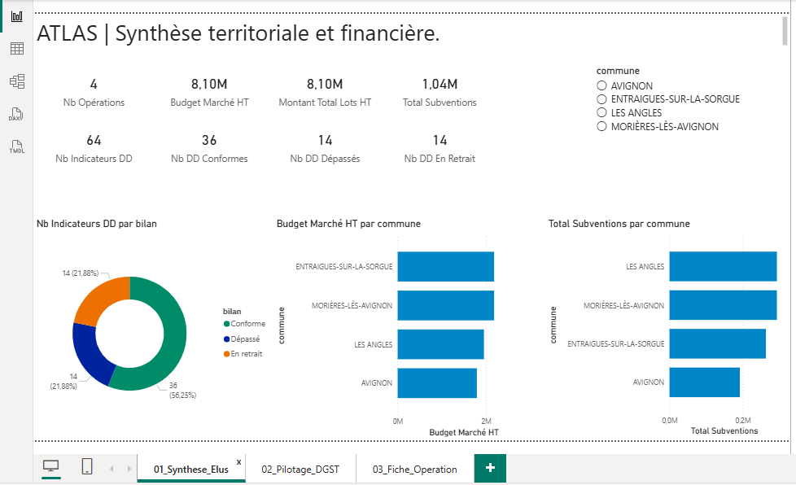
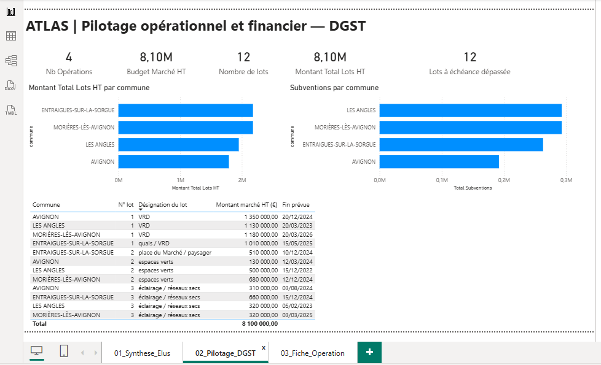
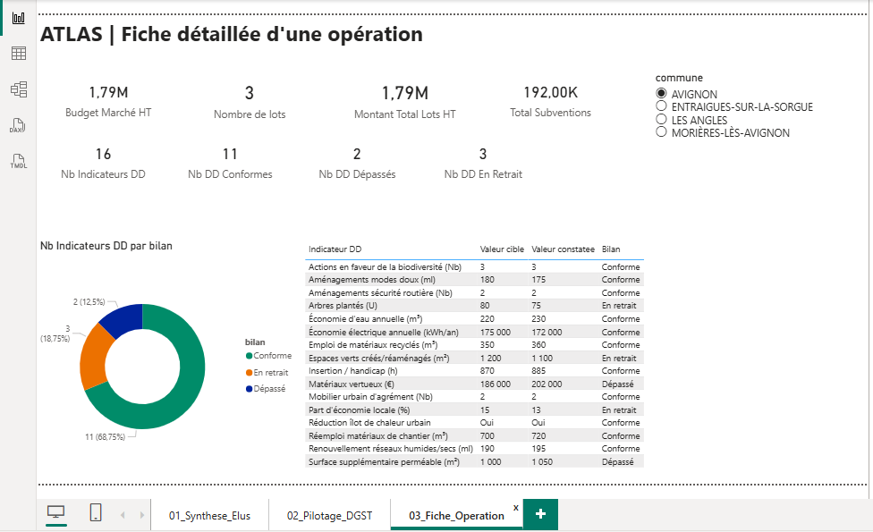

# ATLAS — Pipeline Data Engineering et pilotage territorial

## Besoin

Transformer des informations de suivi d'opérations d'aménagement territorial, dispersées dans des documents métier, en données structurées, fiables et exploitables pour la prise de décision.

Projet réalisé dans le cadre d'un stage Data Engineering chez **DDATAS**, validé par OpenClassrooms.

Le prototype porte sur quatre opérations pilotes et vise à faciliter le suivi des budgets, des marchés, des subventions et des indicateurs de développement durable.

## Solution réalisée

- Analyse des besoins métier et conception d'un modèle de données V1 (MCD, MLD et dictionnaire).
- Simplification du modèle en V2 après prise en compte des retours métier.
- Développement d'extracteurs Python modulaires pour traiter les documents Word.
- Validation et export des données en CSV.
- Chargement des données dans PostgreSQL sous Docker.
- Transformation des données avec dbt, selon les couches `raw`, `staging` et `mart`.
- Mise en place de tests de qualité techniques et métier.
- Réalisation d'un dashboard Power BI comprenant trois vues décisionnelles.
- Connexion et vérification des cinq tables analytiques PostgreSQL dans Power Query.

## Technologies

Python · PostgreSQL · SQL · dbt · Docker · Power BI · Power Query · DAX · Git

## Architecture

```text
Documents métier Word
         |
         v
Extraction et validation Python
         |
         v
Fichiers CSV RAW
         |
         v
PostgreSQL — raw
         |
         v
dbt — staging
         |
         v
dbt — mart
         |
         v
Power Query / Power BI
```

Une nouvelle version du tableau de bord Power BI a été construite à partir des cinq tables analytiques mart de PostgreSQL. Elle comprend trois pages décisionnelles : Synthèse Élus, Pilotage DGST et Fiche Opération. Les relations et les filtres ont été vérifiés sur les quatre opérations pilotes. Cette version constitue un prototype fonctionnel ; l'automatisation complète du pipeline et son exploitation en production restent à réaliser.

## Choix techniques

| Choix | Justification |
|---|---|
| Python modulaire | Séparer extraction, validation et chargement |
| PostgreSQL | Centraliser les données dans une base relationnelle |
| Docker | Faciliter la reproductibilité de l'environnement |
| dbt | Organiser les transformations SQL et les tests |
| Modèle V2 simplifié | Répondre aux besoins métier sans complexité excessive |
| Power BI | Fournir des indicateurs accessibles aux décideurs |
| Ingestion Python plutôt qu'Airbyte | Réduire les besoins en ressources pour le prototype |

## Résultats vérifiés

| Indicateur | Résultat |
|---|---|
| Opérations pilotes | 4 |
| Enregistrements budgets | 16 |
| Enregistrements lots | 12 |
| Enregistrements subventions | 24 |
| Indicateurs de développement durable | 64 |
| Modèles dbt | 10 : 5 staging et 5 marts |
| Tests dbt | 14/14 réussis |
| Vues décisionnelles Power BI | 3 |
| Tables PostgreSQL vérifiées dans Power Query | 5 |

Les trois vues Power BI sont :

- **Synthèse Élus** : vue globale du portefeuille.
- **Pilotage DGST** : budgets, marchés et financements.
- **Fiche Opération** : analyse détaillée d'une opération sélectionnée.

## Tableau de bord Power BI

Le tableau de bord ATLAS a été reconstruit à partir des cinq tables analytiques `mart` issues de PostgreSQL et dbt. Les relations du modèle et les filtres ont été vérifiés sur les quatre opérations pilotes.

### 1. Synthèse Élus

Vue globale des quatre opérations : budgets, subventions et indicateurs de développement durable.



### 2. Pilotage DGST

Suivi des budgets, des 12 lots de travaux, des subventions et des échéances prévues. L'indicateur d'échéance dépassée est calculé à partir des dates du jeu de données et ne constitue pas une confirmation de retard sur le terrain.



### 3. Fiche Opération

Analyse détaillée d'une opération sélectionnée : budget, lots, subventions et 16 indicateurs de développement durable, avec comparaison entre valeurs cibles et constatées.



## Limites et améliorations envisagées

- Envisager la migration de l'ancien modèle sémantique Power BI V2 vers la nouvelle architecture analytique. Un nouveau tableau de bord     fonctionnel, directement connecté aux cinq tables mart, a déjà été réalisé et testé.
- Étendre le périmètre au-delà des quatre opérations pilotes.
- Standardiser davantage les documents sources.
- Intégrer les informations réelles de paiement et de clôture lorsqu'elles seront disponibles.
- Mettre en place une orchestration automatique avec Kestra.
- Ajouter la supervision et des contrôles d'exploitation.

Certains montants de paiement ont été simulés exclusivement pour les démonstrations. Ils sont identifiés séparément des données métier réelles.

## Code et documentation

[Consulter le dépôt ATLAS](https://github.com/nic2025-g/ATLAS/tree/refactor/modele-v2)

[Retour au portfolio](../../README.md)