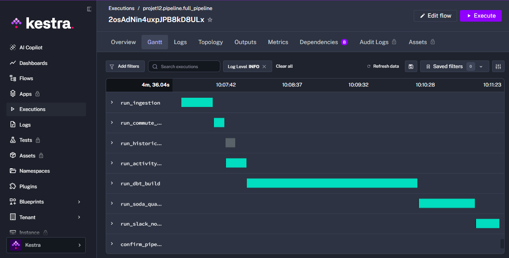
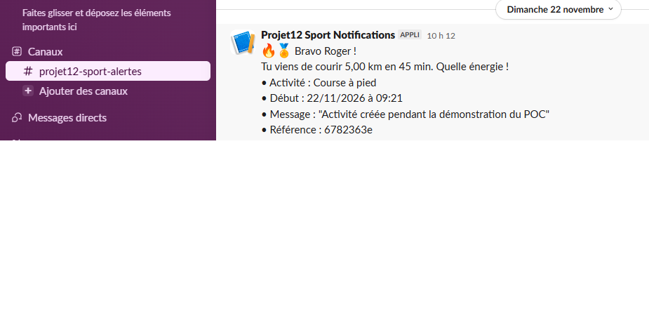
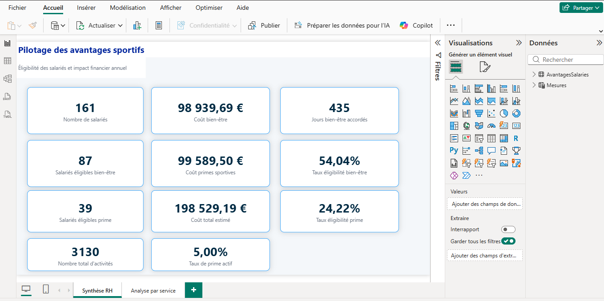

# Avantages Sportifs — pipeline de données de bout en bout

## Besoin

Concevoir un POC permettant de contrôler les déclarations de mobilité
active des salariés, de traiter leurs activités sportives et d’évaluer
leur éligibilité à différents avantages.

La solution doit également assurer la traçabilité des traitements,
la qualité des données et la restitution des indicateurs RH et financiers.

Projet 12 OpenClassrooms :
« Gérez un projet d’infrastructure de données ».

## Solution réalisée

Le projet met en œuvre un pipeline hybride associant traitements batch
et événements en streaming.

Il couvre :

- l’ingestion sécurisée de fichiers RH et sportifs ;
- le contrôle des distances domicile–entreprise ;
- la simulation d’activités sportives sur douze mois ;
- la publication et la consommation d’événements ;
- les transformations et tests métier ;
- les contrôles de qualité ;
- l’orchestration des traitements ;
- la notification Slack d’une activité de démonstration ;
- le calcul des avantages et de leur impact financier ;
- la restitution dans Power BI.

## Architecture

```text
Fichiers Excel
      |
      v
Ingestion Python
      |
      v
PostgreSQL — raw
      |
      +-------------------------+
      |                         |
      v                         v
Contrôle des distances      Redpanda
      |                     activités
      |                         |
      +------------+------------+
                   |
                   v
             dbt staging
                   |
                   v
           dbt intermediate
                   |
                   v
      mart.fct_employee_benefits
             |             |
             v             v
          Soda Core     Power BI

Kestra orchestre et suit les différentes étapes.
Slack reçoit les notifications de la démonstration live.
```

## Démonstration visuelle

### Pipeline orchestré avec Kestra

Le diagramme de Gantt présente l’exécution du pipeline complet :
ingestion, contrôle des déplacements, traitement des activités,
transformations dbt, contrôles Soda et notification Slack.



### Notification Slack en direct

Une activité fictive publiée dans Redpanda est consommée, enregistrée
puis transmise une seule fois au canal Slack de démonstration.



### Tableau de bord Power BI

La page de synthèse présente les volumes traités, les critères
d’éligibilité et l’impact financier estimé.


## Technologies

Python · PostgreSQL · Redpanda · dbt · Soda Core · Kestra · Slack · Power BI · Docker Compose · pytest

## Responsabilité des composants

| Composant | Rôle |
|---|---|
| Python | Ingestion, validation, simulation, publication et consommation |
| PostgreSQL | Stockage des sources, résultats, paramètres et audits |
| Redpanda | Transport des événements d’activités sportives |
| dbt | Normalisation, calculs métier et tests |
| Soda Core | Contrôle de la qualité des différentes couches |
| Kestra | Orchestration, planification et suivi des exécutions |
| Slack | Notification des activités de démonstration |
| Power BI | Analyse des indicateurs RH et financiers |
| Docker Compose | Exécution reproductible de l’infrastructure |

Airbyte n’a pas été retenu : les sources initiales sont des fichiers
locaux et une ingestion Python testée était plus proportionnée au POC.

## Modèle de données

Les données sont organisées en six couches PostgreSQL :

| Couche | Contenu |
|---|---|
| `raw` | Données chargées sans transformation métier |
| `staging` | Données nettoyées, typées et normalisées |
| `intermediate` | Profils salariés et agrégats d’activités |
| `mart` | Indicateurs destinés au pilotage |
| `audit` | Exécutions, rejets et publications |
| `config` | Règles métier versionnées |

La table finale `mart.fct_employee_benefits` rassemble les critères
d’éligibilité, les avantages attribués et les coûts estimés pour chaque
salarié.

## Règles métier versionnées

Les règles sont conservées dans `config.benefit_rules` avec leur version
et leur période de validité.

La configuration de référence prévoit notamment :

- une prime sportive correspondant à 5 % du salaire annuel brut ;
- un seuil de 15 activités pour le dispositif bien-être ;
- l’attribution de 5 jours de bien-être ;
- une distance maximale de 15 km pour la marche ou la course ;
- une distance maximale de 25 km pour le vélo et la mobilité active.

Une règle temporaire de démonstration à 6 % a été activée pendant la
soutenance, puis la configuration initiale a été restaurée.

## Streaming et idempotence

Chaque activité possède un `event_id` stable.

Le consommateur contrôle le contrat de données et empêche l’insertion
multiple d’un même événement. Les exécutions et les lots disposent
également d’identifiants techniques permettant l’audit et le rejeu.

Une activité fictive peut être publiée en direct dans le topic
`sport.activities.v1`, consommée, enregistrée puis notifiée dans Slack.

## Orchestration

Le pipeline principal Kestra enchaîne notamment :

1. l’ingestion des sources ;
2. la validation des distances ;
3. la consommation des activités ;
4. la construction et les tests dbt ;
5. les contrôles Soda ;
6. la notification Slack ;
7. la confirmation de fin de traitement.

La publication historique reste facultative afin d’éviter une
republication involontaire de tous les événements.

## Qualité et tests

| Vérification | Résultat de référence |
|---|---:|
| Tests Python | 73 réussis |
| Tests et modèles dbt | PASS=131, WARN=0, ERROR=0 |
| Contrôles Soda | 24/24 réussis |
| Pipeline Kestra de démonstration | Succès |
| Notification d’activité Slack | Reçue |
| Actualisation du rapport Power BI | Vérifiée |

## Résultats métier de référence

| Indicateur | Résultat |
|---|---:|
| Salariés analysés | 161 |
| Éligibles à la prime sportive | 39 |
| Éligibles au dispositif bien-être | 87 |
| Jours de bien-être accordés | 435 |
| Primes sportives estimées | 99 589,50 € |
| Coût bien-être estimé | 98 939,69 € |
| Coût total estimé | 198 529,19 € |

## Tableau de bord Power BI

Le rapport comprend :

- une page de synthèse RH ;
- une analyse par service ;
- les indicateurs d’éligibilité ;
- les coûts sportifs et de bien-être ;
- des filtres par type de contrat.

Seul le modèle `.pbit` sans données importées est versionné. Le fichier
`.pbix`, susceptible de contenir des données RH, reste local.

## Sécurité et protection des données

Les mesures appliquées comprennent :

- exclusion des fichiers RH du dépôt Git ;
- stockage local des secrets dans un fichier `.env` ignoré ;
- absence d’adresses, de salaires et de dates de naissance dans les logs ;
- utilisation de données fictives dans les exemples versionnés ;
- modèle Power BI publié sans données importées ;
- utilisateur PostgreSQL applicatif avec des droits limités ;
- utilisation par défaut d’un fournisseur de distance simulé.

## Incident résolu

Deux exécutions ont échoué parce que l’horloge du conteneur applicatif
et celle de PostgreSQL présentaient un léger décalage.

La date de fin calculée par Python pouvait alors être antérieure à la
date de début enregistrée par PostgreSQL, ce qui violait la contrainte
`ended_at >= started_at`.

La correction a consisté à calculer la clôture directement dans
PostgreSQL :

```sql
ended_at = GREATEST(clock_timestamp(), started_at)
```

Cette correction a été appliquée aux cinq traitements concernés.
Les 73 tests automatisés ont ensuite réussi et les pipelines Kestra
ont été rejoués avec succès.

## Limites

- calcul des distances réalisé avec un fournisseur simulé ;
- infrastructure locale mono-nœud ;
- absence de haute disponibilité ;
- secrets locaux plutôt que stockés dans un coffre dédié ;
- actualisation Power BI manuelle ;
- absence de déploiement cloud ;
- supervision et alertes techniques encore limitées.

## Améliorations envisagées

- ajouter une alerte technique en cas d’échec d’un pipeline ;
- stocker les secrets dans un coffre dédié ;
- automatiser l’actualisation Power BI ;
- déployer l’infrastructure dans le cloud ;
- renforcer la supervision et la gouvernance ;
- intégrer un fournisseur cartographique réel avec cache géographique.

## Dépôt technique

[Consulter le dépôt GitHub du projet](https://github.com/nic2025-g/projet12-avantages-sportifs)

Le dépôt contient le code Python, les workflows Kestra, les modèles dbt,
les contrôles Soda, le modèle Power BI sécurisé et la documentation
technique détaillée.

[Retour au portfolio](../../README.md)
