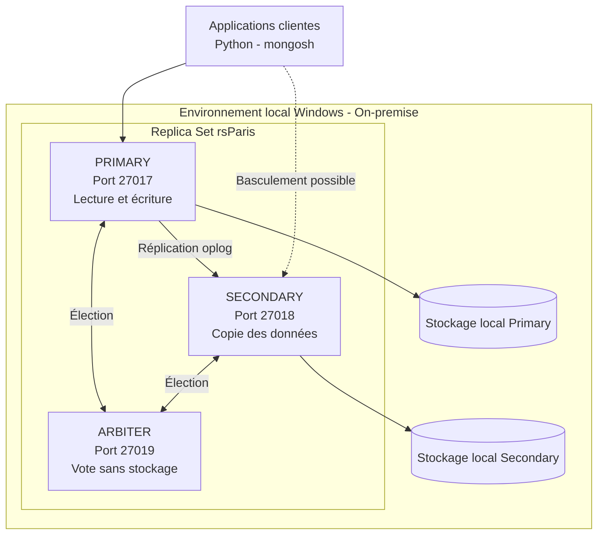

# Architecture physique on-premise avec MongoDB

## 1. Objectif

Mettre en place une architecture de réplication MongoDB
permettant d'améliorer la disponibilité des données
et d'étudier les mécanismes de basculement automatique.

## 2. Architecture du projet initial

## 3. Description des composants

| Composant | Port | Rôle |
|---|---:|---|
| Primary | 27017 | Réception des écritures et lecture des données |
| Secondary | 27018 | Réplication des données du Primary |
| Arbiter | 27019 | Participation aux élections sans stockage des données |
| Replica Set | - | Coordination des membres et gestion des élections |
| Applications clientes | - | Connexion et exploitation des données |

## 4. Fonctionnement de la réplication

Le Primary reçoit les opérations d'écriture.

Le Secondary réplique les opérations enregistrées
dans l'oplog afin de maintenir une copie des données.

L'Arbiter participe aux élections mais ne possède
aucune copie des données.

Les rôles Primary et Secondary peuvent évoluer
après une élection.

## 5. Scénario de basculement

En cas d'indisponibilité du Primary :

1. Les membres détectent son indisponibilité.
2. Une nouvelle élection peut être déclenchée.
3. Le Secondary peut devenir Primary s'il est éligible
   et obtient la majorité des votes.
4. Les applications clientes compatibles avec les
   Replica Sets peuvent retrouver le nouveau Primary.
5. L'ancien Primary peut rejoindre le Replica Set
   comme Secondary après son rétablissement.

Une interruption temporaire des écritures peut
survenir pendant l'élection.

## 6. Avantages et limites

| Avantages | Limites |
|---|---|
| Redondance des données | Consommation supplémentaire de stockage |
| Basculement automatique possible | Interruption temporaire pendant une élection |
| Amélioration de la disponibilité | Complexité de configuration et de maintenance |
| Arbitrage avec peu de ressources | L'Arbiter ne stocke aucune donnée |
| Réplication des opérations | Retard de réplication possible |

L'utilisation d'un Arbiter ne remplace pas une
troisième copie des données.

Avec seulement deux membres stockant les données,
la perte de l'un d'eux peut empêcher la confirmation
des écritures avec writeConcern majority.

## 7. Recommandations pour la production

- Utiliser trois membres stockant les données.
- Répartir les membres sur des machines indépendantes.
- Activer l'authentification et le contrôle des accès.
- Sécuriser les communications avec TLS.
- Surveiller le retard de réplication.
- Mettre en place des sauvegardes régulières.
- Tester les procédures de restauration et de basculement.

## 8. Périmètre de validation

L'architecture du projet initial repose sur plusieurs
instances MongoDB dans un environnement local.

Elle permet d'étudier les mécanismes de réplication
et d'élection, mais ne protège pas contre une panne
complète de la machine physique qui héberge les instances.

La configuration historique est documentée dans le
support de présentation du projet.

Le Replica Set n'a pas été redéployé lors de la
préparation du portfolio en novembre 2026.

## 9. Valeur ajoutée métier

La réplication contribue à réduire les risques
d'interruption de service et de perte de données.

Elle améliore la résilience de l'infrastructure
et facilite la continuité des activités.

Elle ne remplace toutefois pas une stratégie
de sauvegarde et de restauration.
