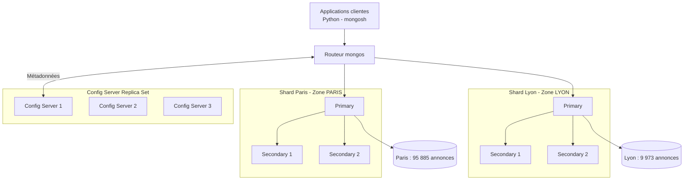

# Architecture distribuée avec sharding MongoDB

## 1. Objectif

Concevoir une architecture MongoDB distribuée permettant
d'accompagner l'augmentation du volume des données Airbnb
et d'améliorer la scalabilité horizontale du système.

Cette architecture constitue une proposition d'évolution
et non un déploiement validé en production.

## 2. Schéma de l'architecture proposée



## 3. Description des composants

| Composant | Rôle |
|---|---|
| mongos | Routage des requêtes vers les shards concernés |
| Config Server Replica Set | Stockage des métadonnées du cluster |
| Shard Paris | Stockage des données associées à la zone Paris |
| Shard Lyon | Stockage des données associées à la zone Lyon |
| Replica Sets | Réplication et disponibilité des données de chaque shard |
| Balancer | Gestion de la distribution des plages de données |
| Shard key | Détermination du partitionnement des documents |
| Zones | Association de plages de clés à certains shards |

## 4. Stratégie de partitionnement

Une première approche consiste à répartir les données
selon leur ville d'origine.

Le champ city permet de distinguer les annonces de Paris
et celles de Lyon.

Cependant, utiliser uniquement city comme clé de sharding
présente plusieurs limites :

- Faible cardinalité : seulement deux valeurs distinctes.
- Déséquilibre important des volumes.
- Difficulté à subdiviser les données d'une même ville.
- Risque de concentration de la charge sur un seul shard.

Une clé composée constitue une alternative à étudier :

```javascript
{ city: 1, id: 1 }
```

Cette proposition suppose que le champ id représente
un identifiant stable de l'annonce, correctement renseigné
et normalisé dans les deux sources.

La clé composée permet de conserver la dimension
géographique tout en augmentant la cardinalité.

Son efficacité doit être évaluée selon les requêtes,
la distribution des identifiants et les écritures.

La configuration des zones nécessite également
l'association des shards aux zones et la définition
des plages de clés correspondantes.

## 5. Répartition historique des données

| Ville | Nombre d'annonces | Pourcentage |
|---|---:|---:|
| Paris | 95 885 | 90,58 % |
| Lyon | 9 973 | 9,42 % |
| Total | 105 858 | 100 % |

Le volume parisien est environ 9,6 fois supérieur
au volume lyonnais.

Une répartition strictement géographique risque donc
de créer un déséquilibre de stockage et de charge.

La clé composée permet de subdiviser les données
d'une ville, mais ne supprime pas automatiquement
le déséquilibre entre les zones.

L'ajout de shards dans la zone Paris pourrait être
envisagé si la croissance des données le justifie.

## 6. Comparaison entre réplication et sharding

| Critère | Réplication | Sharding |
|---|---|---|
| Objectif | Disponibilité | Scalabilité horizontale |
| Organisation | Duplication | Partitionnement |
| Stockage | Copies des données | Répartition des données |
| Disponibilité | Élections et basculement | Réplication de chaque shard |
| Complexité | Modérée | Élevée |
| Coût | Supplémentaire | Généralement plus important |

Les deux mécanismes sont complémentaires.

Chaque shard peut être constitué d'un Replica Set
afin d'améliorer sa disponibilité.

## 7. Avantages et limites

### Avantages

- Augmentation progressive de la capacité de stockage.
- Distribution de la charge entre plusieurs shards.
- Possibilité de cibler certaines requêtes géographiques.
- Accompagnement de la croissance des données.
- Disponibilité améliorée grâce aux Replica Sets.

### Limites

- Infrastructure plus coûteuse.
- Administration et supervision plus complexes.
- Risque de déséquilibre entre les shards.
- Importance du choix de la clé de partitionnement.
- Requêtes distribuées potentiellement plus coûteuses.
- Maintenance et sauvegardes plus complexes.

## 8. Sécurité et supervision

- Authentification des utilisateurs et des services.
- Contrôle des accès selon les rôles.
- Chiffrement des communications avec TLS.
- Isolation réseau des composants.
- Surveillance de la charge CPU et mémoire.
- Surveillance de l'espace disque.
- Surveillance du retard de réplication.
- Contrôle de la distribution des données.
- Sauvegardes cohérentes à l'échelle du cluster.

## 9. Recommandation technique

Pour un volume de 105 858 documents, le sharding
n'est pas nécessairement justifié.

Une architecture MongoDB avec réplication et des
index adaptés peut constituer une solution suffisante.

Le passage au sharding doit être motivé par des
mesures de performance, des contraintes de capacité
ou des perspectives de croissance significatives.

Il est recommandé de mesurer les performances
avant d'augmenter la complexité de l'infrastructure.

## 10. Périmètre de validation

Cette architecture représente une proposition
d'évolution étudiée dans le cadre du projet.

Les volumes utilisés correspondent aux résultats
historiques de l'intégration des données.

Le cluster distribué n'a pas été redéployé ni testé
lors de la préparation du portfolio en novembre 2026.

Aucun gain de performance lié au sharding n'est
revendiqué sans mesure expérimentale.

## 11. Valeur ajoutée métier

Cette architecture permet d'anticiper la croissance
du volume des données et l'intégration de nouvelles
villes dans le système.

Elle contribue à la conception d'une infrastructure
évolutive, tout en tenant compte des contraintes
de disponibilité, de performance et de coût.
