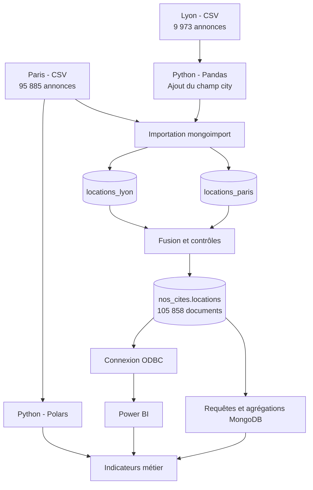

# Architecture du pipeline de données Airbnb

## 1. Objectif

Collecter, préparer, intégrer et exploiter les données
Airbnb de Paris et de Lyon dans un environnement MongoDB.

## 2. Schéma du pipeline

## 3. Description des composants

| Composant | Rôle |
|---|---|
| CSV Paris | Source de 95 885 annonces |
| CSV Lyon | Source de 9 973 annonces |
| Python / Pandas | Préparation et enrichissement des données |
| mongoimport | Importation des fichiers dans MongoDB |
| MongoDB | Stockage documentaire et agrégations |
| Polars | Analyse statistique des données |
| ODBC | Interface de connexion aux outils décisionnels |
| Power BI | Exploitation et visualisation des données |

## 4. Contrôles de qualité

- Vérification de la disponibilité des fichiers sources.
- Contrôle du nombre de lignes avant et après préparation.
- Vérification du champ city.
- Contrôle des volumes avant et après fusion.
- Comparaison des indicateurs statistiques historiques.

## 5. Résultats

- Paris : 95 885 annonces.
- Lyon : 9 973 annonces.
- Volume consolidé historique : 105 858 documents.
- Onze analyses statistiques reproduites avec Polars.

## 6. Reproductibilité

Les scripts Python ont été testés sur les données réelles.

Les scripts MongoDB reconstruits pour le portfolio ont
été vérifiés en mode simulation.

La fusion réelle n'a pas été réexécutée lors de cette
phase de préparation du portfolio.

La base nos_cites_demo est utilisée comme cible de
démonstration dans les nouveaux scripts.

## 7. Sécurité et confidentialité

Les fichiers sources volumineux et les données
personnelles des hôtes ne sont pas publiés sur GitHub.

Les paramètres de connexion doivent être configurés
en dehors du code source.

## 8. Valeur ajoutée métier

Cette architecture permet de centraliser les données
de plusieurs villes, de faciliter leur exploitation
et de produire des indicateurs utiles à la prise
de décision.
