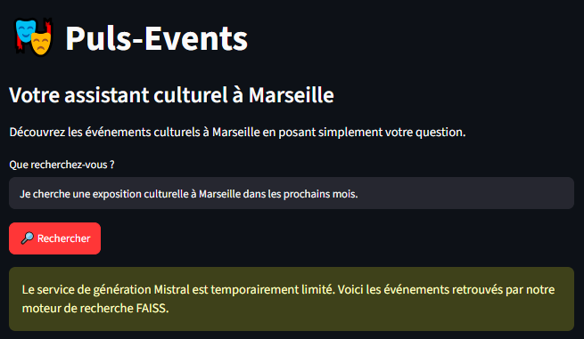
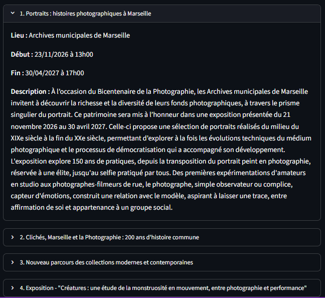

# 🎭 Puls-Events — Assistant culturel intelligent avec RAG

**Projet Data Engineering & Intelligence Artificielle — OpenClassrooms**

## 1. Présentation du projet

Puls-Events est un prototype d'assistant intelligent permettant de rechercher des événements culturels à Marseille à partir de questions formulées en langage naturel.

L'objectif est de faciliter la découverte d'expositions, de concerts et d'autres activités culturelles grâce à une architecture **RAG (Retrieval-Augmented Generation)**.

Le système associe une recherche sémantique dans une base vectorielle à un modèle de langage pour produire des recommandations contextualisées.

**Dépôt source :** https://github.com/nic2025-g/projet11-rag-puls-events

## 2. Problématique métier

Les informations sur les événements culturels sont souvent dispersées entre plusieurs agendas et plateformes.

Puls-Events répond à trois besoins :

- Centraliser et préparer les informations issues d'OpenAgenda.
- Permettre une recherche en langage naturel, au-delà des mots-clés exacts.
- Présenter des événements pertinents dans une interface accessible.

**Exemple de question :**

> Je cherche une exposition gratuite à Marseille.

## 3. Architecture technique

Le projet repose sur une chaîne de traitement des données suivie d'un système de recherche et de génération.

```text
OpenAgenda (sources d'événements)
              |
              v
Collecte des données — Python
              |
              v
Nettoyage et filtrage
              |
              v
Découpage des descriptions (chunking)
              |
              v
Mistral Embeddings — mistral-embed
              |
              v
Index vectoriel FAISS
              |
              v
Recherche sémantique
              |
              v
LangChain + Mistral LLM
              |
              v
Interface Web Streamlit
```

En cas d'erreur HTTP 429 du service de génération Mistral, l'interface propose un mode de secours fondé sur les résultats FAISS, sans génération de réponse par le LLM.

## 4. Technologies utilisées

| Technologie | Utilisation |
|---|---|
| Python | Collecte, préparation et traitement des données |
| OpenAgenda | Source des événements culturels |
| Mistral AI | Embeddings et génération de réponses |
| FAISS | Indexation vectorielle et recherche par similarité |
| LangChain | Orchestration de la chaîne RAG |
| Streamlit | Interface Web interactive |
| Pytest | Tests automatisés |
| Git et GitHub | Versionnement et collaboration |
| GitHub Actions | Intégration continue |

## 5. Fonctionnalités développées

### Préparation des données

- Collecte des événements depuis OpenAgenda.
- Filtrage géographique et métier.
- Nettoyage des descriptions.
- Découpage des textes longs en segments.
- Génération de vecteurs de 1 024 dimensions.
- Construction d'un index FAISS.

### Recherche intelligente

- Interrogation en langage naturel.
- Recherche sémantique des événements.
- Construction d'un contexte pour le modèle de langage.
- Génération de réponses lorsque le service Mistral est disponible.

### Interface Web Streamlit

- Champ de saisie des questions.
- Bouton de recherche.
- Présentation des événements avec titre, lieu, dates et description.
- Filtrage des événements terminés dans le mode de secours.
- Gestion de certaines erreurs de l'API Mistral.

### Aperçu de l'application

L'interface Web permet à l'utilisateur de formuler une recherche culturelle en langage naturel.

**Interface de recherche Puls-Events**



*L'application propose un mode de secours FAISS lorsque la génération de réponses par Mistral est temporairement indisponible.*

**Exemple de résultat détaillé**



*Exemple d'une exposition aux Archives municipales de Marseille, avec le lieu, les dates et la description de l'événement.*

## 6. Résultats et validation

Le prototype a été développé et validé dans le cadre de la formation OpenClassrooms.

**Indicateurs techniques :**

| Indicateur | Résultat |
|---|---|
| Dimension des embeddings | 1 024 |
| Moteur de recherche vectorielle | FAISS |
| Interface Web | Streamlit |
| Tests automatisés locaux | 39 réussis |
| Contrôles GitHub Actions lors de la PR Streamlit | 2 réussis |
| Intégration de l'interface dans `main` | PR #14 fusionnée |

Les tests couvrent notamment la préparation des données, les fonctionnalités RAG et les fonctions de présentation de l'interface.

## 7. Difficultés techniques et solutions

### Disponibilité de l'API Mistral

**Difficulté :** certaines requêtes de génération renvoient une erreur HTTP 429 liée aux limites du service.

**Solution :** ajout d'un mécanisme de secours qui récupère directement les événements pertinents depuis FAISS et les affiche dans Streamlit.

**Limite :** ce mode de secours dépend toujours de l'API d'embeddings Mistral pour transformer la question en vecteur.

### Pertinence des recommandations

**Difficulté :** une recherche sémantique peut retourner un événement proche du sens de la question sans respecter toutes les contraintes demandées.

**Approche :** filtrage des événements terminés dans le mode de secours et documentation des limites restantes.

La gratuité, par exemple, n'est pas systématiquement garantie par la seule similarité vectorielle.

## 8. Compétences démontrées

Ce projet m'a permis de mettre en pratique plusieurs compétences :

- Concevoir un pipeline de préparation de données textuelles.
- Intégrer une API externe dans une application Python.
- Construire et interroger une base vectorielle.
- Mettre en œuvre une architecture RAG avec LangChain.
- Développer une interface Web avec Streamlit.
- Gérer les erreurs et prévoir un fonctionnement dégradé.
- Écrire des tests automatisés et utiliser GitHub Actions.
- Documenter et versionner un projet logiciel.

## 9. Exécution du projet

Le code complet et les instructions d'installation sont disponibles dans le dépôt source :

**[Consulter Puls-Events sur GitHub](https://github.com/nic2025-g/projet11-rag-puls-events)**

Une fois les dépendances installées, les variables d'environnement configurées et l'index FAISS disponible, l'interface peut être lancée avec :

```powershell
python -m streamlit run app.py
```

Puis ouverte à l'adresse :

http://localhost:8501

## 10. Perspectives d'amélioration

- Stabiliser l'accès au service de génération Mistral.
- Renforcer les filtres métier, notamment la gratuité et les dates.
- Ajouter des tests d'intégration pour les interactions Streamlit.
- Améliorer la présentation visuelle des résultats.
- Étudier les possibilités de déploiement de l'application.

---

**Statut :** POC académique validé — interface Streamlit intégrée au dépôt principal.

**Dépôt GitHub :** https://github.com/nic2025-g/projet11-rag-puls-events
